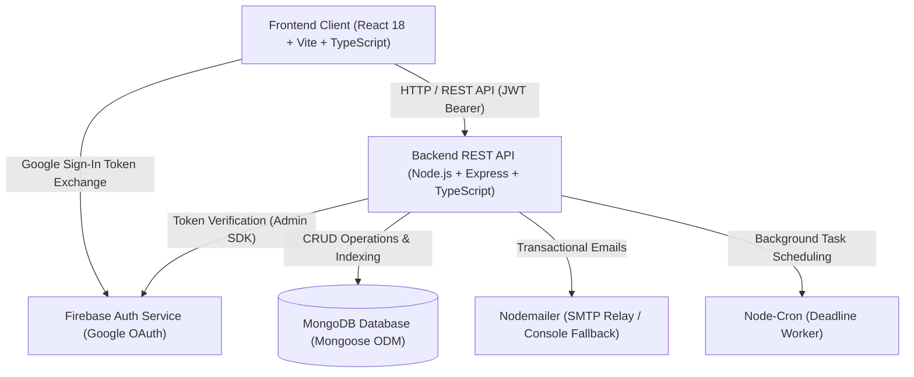
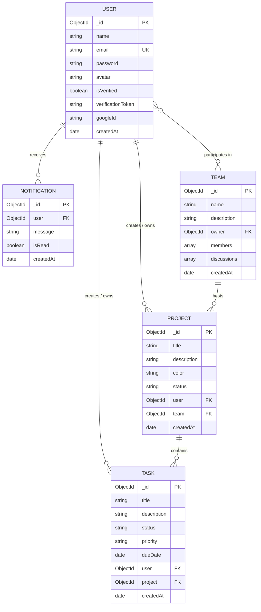
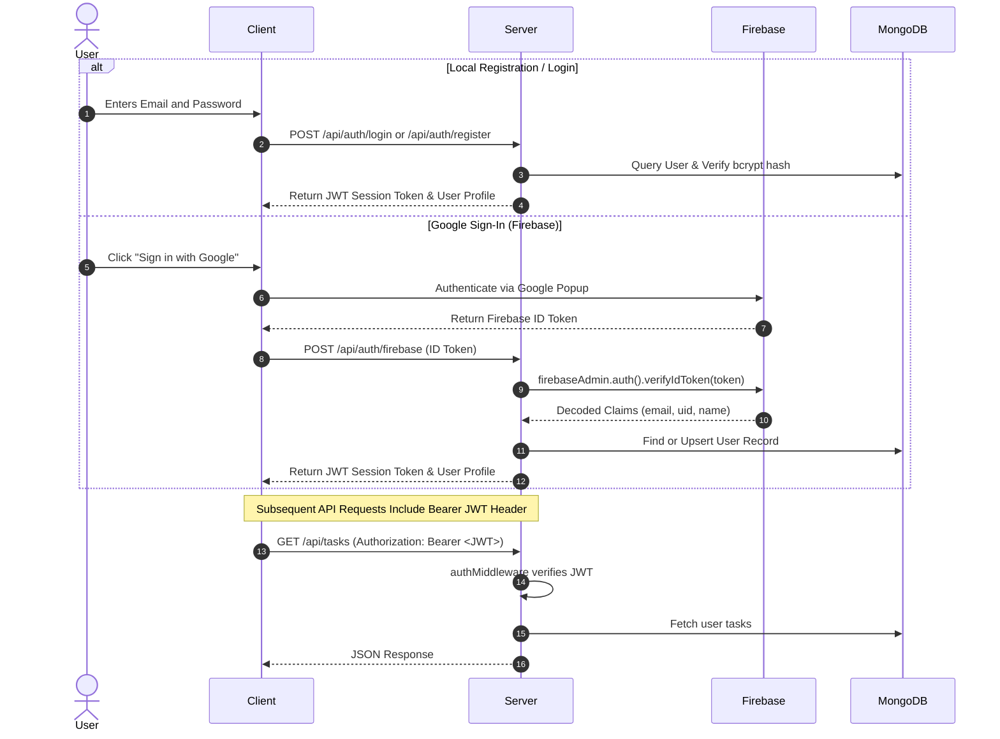

# Taskify System Architecture and Design

This document details the architectural principles, component structure, data models, and runtime services that power Taskify.

---

## 1. System Overview

Taskify is a full-stack, type-safe task and workflow management platform implemented with a decoupled client-server architecture. The application is maintained as a monorepo containing a React Single Page Application (SPA) frontend and an Express REST API backend, backed by MongoDB for persistent data storage.

---

## 2. Architectural Design Principles

- **End-to-End Type Safety**: Shared TypeScript paradigms and domain definitions across both frontend and backend ensure reliable API contracts and strict runtime guarantees.
- **Decoupled Client and Server**: The client is fully isolated as an independent Single Page Application, communicating with the server exclusively via JSON over REST.
- **Fail-Safe Resilience**: Core services, such as email dispatch and background tasks, degrade gracefully without crashing the main application loop.
- **Demo-First Capability**: A client-side mock service engine allows full evaluation of the application interface without requiring an active database or network connection.
- **Modular Component Hierarchy**: Strict separation between page views, reusable presentation components, context state providers, and external API services.

---

## 3. Frontend Architecture

The client application is built with React 18, bundled with Vite, and styled using Tailwind CSS.

### 3.1 Technology Stack

- **Framework**: React 18
- **Build Tool**: Vite 5
- **Language**: TypeScript 5
- **Routing**: React Router DOM v6
- **Styling**: Tailwind CSS v3 with PostCSS and Autoprefixer
- **Motion & Interactions**: Framer Motion
- **Iconography**: Lucide React
- **Data Visualization**: Recharts
- **Date Manipulation**: date-fns
- **Authentication Client**: Firebase Client SDK

### 3.2 Directory Structure (`client/src/`)

- `components/`: Modular reusable interface components (`Sidebar`, `DemoSidebar`, `ProjectAssistant`, `Layout`).
- `config/`: Third-party SDK initializations, including Firebase Web Client.
- `context/`: Application-wide context providers:
  - `AuthContext.tsx`: Tracks session tokens, active user profile, login, registration, and logout states.
  - `ThemeContext.tsx`: Manages workspace presentation preferences.
- `hooks/`: Custom React hooks:
  - `useSpeechToText.ts`: Interacts with the browser Web Speech API (`SpeechRecognition` / `webkitSpeechRecognition`) to convert dictated audio into task descriptions.
- `layouts/`: Master route wrapper templates (`DashboardLayout.tsx`, `DemoDashboardLayout.tsx`).
- `pages/`: Primary application views:
  - `LandingPage.tsx`: Public project presentation page.
  - `AuthPage.tsx`: Integrated sign-in, registration, and Google OAuth view.
  - `VerifyEmail.tsx`: Token-based email verification confirmation page.
  - `Dashboard.tsx`: Top-level dashboard router.
  - `dashboard/`: Authenticated routes (`DashboardHome`, `MyProjects`, `MyTasks`, `Profile`, `Settings`, `Status`, `Teams`, `TeamDetails`).
  - `demo/`: Isolated demo mode views mirroring production features using local mock data.
- `services/`: API interaction layer (`api.ts`) managing HTTP requests and token headers.
- `types.ts`: TypeScript interfaces for tasks, projects, teams, users, and API payloads.

---

## 4. Backend Architecture

The backend is built with Express.js running on Node.js, written in TypeScript and executed via `tsx` during development and compiled with `tsc` for production.

### 4.1 Technology Stack

- **Runtime**: Node.js (>=20.x, tested on 24.22.1)
- **Framework**: Express.js 4
- **Language**: TypeScript 5
- **Database Engine**: MongoDB with Mongoose 8
- **Authentication**: JSON Web Tokens (`jsonwebtoken`), `bcryptjs`
- **Federated Auth**: Firebase Admin SDK
- **Scheduler**: Node-Cron
- **Mailing**: Nodemailer
- **CORS**: Cross-Origin Resource Sharing middleware

### 4.2 Layered Backend Structure (`server/`)

The server adheres to a layered controller-service pattern:

1. **Server Entry (`server.ts`)**:
   - Initializes Express application.
   - Configures middleware (CORS, JSON body parser).
   - Establishes MongoDB database connection (`config/db.ts`).
   - Registers top-level health checks (`GET /`, `GET /health`).
   - Mounts API routers.
   - Starts the cron deadline scheduler.

2. **Routes (`routes/`)**:
   - Maps URL endpoints to controller actions.
   - Attaches `authMiddleware` to secure routes.
   - Modules: `authRoutes`, `taskRoutes`, `projectRoutes`, `teamRoutes`, `userRoutes`.

3. **Controllers (`controllers/`)**:
   - Handles HTTP request validation, invokes models and services, and formats JSON responses.
   - Modules: `authController`, `taskController`, `projectController`, `teamController`, `userController`.

4. **Middleware (`middleware/`)**:
   - `authMiddleware.ts`: Extracts the `Bearer <token>` from the HTTP `Authorization` header, verifies the JWT against `JWT_SECRET`, resolves the user from the database, and injects `req.user`.

5. **Services (`services/`)**:
   - `cronService.ts`: Runs scheduled routines via `node-cron` to check upcoming task deadlines and trigger notifications.
   - `emailService.ts`: Sends transactional messages (e.g., account verification links) using SMTP, with graceful fallback to console output in development environments.

6. **Models (`models/`)**:
   - Mongoose schema definitions enforcing document validation and indexing.

---

## 5. Database Schemas and Relationships

### 5.1 Schema Summaries

- **User**: Stores profile identity, credential hashes (`bcryptjs`), verification tokens, and Google account identifiers.
- **Task**: Represents individual actionable items. Includes status states (`Todo`, `In Progress`, `Done`) and priority indicators (`Low`, `Medium`, `High`).
- **Project**: Groups related tasks into distinct initiatives with color-coding and status tags.
- **Team**: Manages shared collaborative groups, member roles, and internal team discussion threads.
- **Notification**: Stores time-sensitive alerts triggered by deadlines or team updates.

---

## 6. Authentication and Authorization Flow

Taskify provides a dual authentication architecture supporting both traditional credential-based sign-in and federated Google Sign-In.

---

## 7. Reliability and Background Services

### 7.1 Scheduled Deadline Monitor
- **File**: `server/services/cronService.ts`
- **Cadence**: Configured via cron expression (`node-cron`).
- **Purpose**: Evaluates tasks approaching their `dueDate`, generates alerts in the `Notification` collection, and triggers notification emails.

### 7.2 Transactional Email Service
- **File**: `server/services/emailService.ts`
- **Engine**: Nodemailer.
- **Behavior**: Transmits account activation tokens. When credentials (`EMAIL_USER`, `EMAIL_PASS`) are unconfigured, the service logs verification links directly to the console so local development remains unblocked.

---

## 8. API Specification

| Endpoint | Method | Middleware | Description |
| :--- | :--- | :--- | :--- |
| `/` | `GET` | Public | Root heartbeat status check |
| `/health` | `GET` | Public | System health check and uptime monitor |
| `/api/auth/register` | `POST` | Public | Registers a new user and sends verification email |
| `/api/auth/login` | `POST` | Public | Authenticates credentials and returns JWT token |
| `/api/auth/firebase` | `POST` | Public | Verifies Firebase ID token and provisions session |
| `/api/auth/verify-email` | `POST` | Public | Validates email token and marks account verified |
| `/api/tasks` | `GET` | `authMiddleware` | Returns all tasks belonging to authenticated user |
| `/api/tasks` | `POST` | `authMiddleware` | Creates a new task |
| `/api/tasks/:id` | `PUT` | `authMiddleware` | Updates task title, status, priority, or due date |
| `/api/tasks/:id` | `DELETE` | `authMiddleware` | Removes an existing task |
| `/api/projects` | `GET` | `authMiddleware` | Lists all projects owned by the user |
| `/api/projects` | `POST` | `authMiddleware` | Creates a new project |
| `/api/teams` | `GET` | `authMiddleware` | Lists all teams the user is a member of |
| `/api/teams` | `POST` | `authMiddleware` | Creates a new collaborative team space |
| `/api/teams/:id/members`| `POST` | `authMiddleware` | Invites or adds a new member to a team |
| `/api/users/profile` | `GET` | `authMiddleware` | Returns current user profile details |

