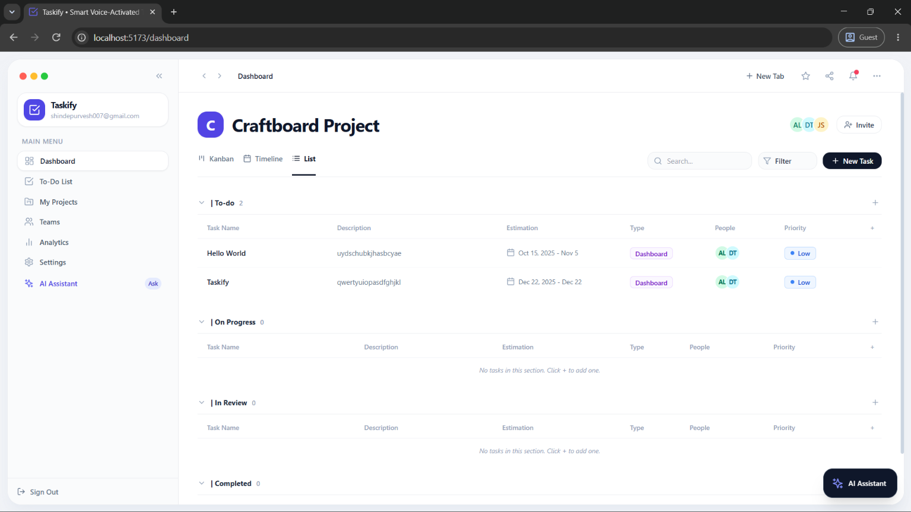
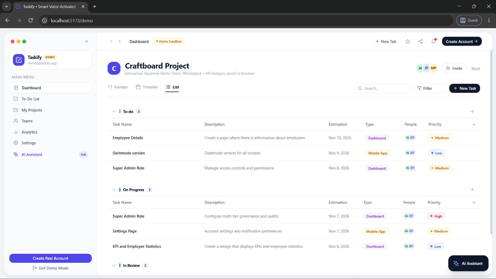

<div align="center">

  
  <h1>Taskify</h1>
  <p><strong>Next-Generation Smart Task &amp; Workflow Management Platform</strong></p>

  <p>
    <a href="./LICENSE">
      
    </a>
    
    
    
    
    
    
    
    
  </p>

  <p align="center">
    <a href="#overview">Overview</a> |
    <a href="#key-features">Key Features</a> |
    <a href="#visual-tour">Visual Tour</a> |
    <a href="#tech-stack">Tech Stack</a> |
    <a href="#documentation">Documentation</a> |
    <a href="#license">License</a>
  </p>
</div>

---

## Overview

Taskify is a modern, production-grade task and workflow management platform designed to help individuals and teams organize projects, boost productivity, and collaborate seamlessly.

Built with the MERN stack and end-to-end TypeScript type-safety across client and server, Taskify features voice-activated task creation via the Web Speech API, an interactive AI project assistant, comprehensive status analytics, collaborative team workspaces, secure dual authentication (JWT + Firebase Google OAuth), and an integrated keep-alive service for reliable cloud hosting.

---

## Key Features

- **Voice and Speech-to-Text Task Creation**: Dictate tasks directly into Taskify using the browser's Web Speech API for hands-free workflow capture.
- **Interactive AI Project Assistant**: Intelligent workspace companion that assists with organizing priorities, suggesting project breakdowns, and optimizing team productivity.
- **Collaborative Team Workspaces**: Create dedicated team spaces, invite members, conduct in-app discussions, and track shared team tasks in real time.
- **Visual Analytics and Status Metrics**: Real-time project completion tracking, distribution charts powered by Recharts, and multi-tier priority filtering.
- **Dual Authentication Architecture**:
  - Email and password registration with cryptographic token verification powered by Nodemailer.
  - One-click Google Sign-In with Firebase Authentication and server-side Firebase Admin ID token verification.
- **Interactive Demo Mode**: Zero-setup evaluation environment allowing users to explore full platform capabilities without requiring database provisioning or account registration.
- **Refined Light Aesthetic and Bento Grid UI**: Clean, distraction-free workspace featuring modular Bento cards, subtle border contrasts, fluid micro-interactions with Framer Motion, and Tailwind CSS typography.
- **Automated Background Jobs and Keep-Alive Engine**: Node-Cron scheduled deadline notifications and an automated 8-minute keep-alive ping engine to prevent cloud hosting instances from idling.

---

## Visual Tour

### Workspace Command Center
<p align="center">
  
</p>

### Interactive Dashboard and Demo Mode
| Dashboard and AI Assistant | Interactive Demo Mode |
| :---: | :---: |
|  |  |

### Collaborative Team Workspaces
<p align="center">
  
</p>

### Authentication Flow
<p align="center">
  
</p>

---

## Tech Stack

### Frontend
- **Framework**: [React 18](https://react.dev/) with [Vite](https://vitejs.dev/)
- **Language**: [TypeScript](https://www.typescriptlang.org/)
- **Styling**: [Tailwind CSS](https://tailwindcss.com/)
- **Icons**: [Lucide React](https://lucide.dev/)
- **Motion and Animations**: [Framer Motion](https://www.framer.com/motion/)
- **Data Visualization**: [Recharts](https://recharts.org/)
- **Client Authentication**: [Firebase Client SDK](https://firebase.google.com/)
- **Date Utilities**: [date-fns](https://date-fns.org/)

### Backend
- **Runtime**: [Node.js](https://nodejs.org/) (>=20 / >=24.22.1)
- **Framework**: [Express.js](https://expressjs.com/)
- **Language and Execution Engine**: [TypeScript](https://www.typescriptlang.org/) with [tsx](https://github.com/privatenumber/tsx)
- **Database**: [MongoDB](https://www.mongodb.com/) via [Mongoose ODM](https://mongoosejs.com/)
- **Security and Tokens**: [JSON Web Tokens (JWT)](https://jwt.io/), [bcryptjs](https://www.npmjs.com/package/bcryptjs)
- **Federated Verification**: [Firebase Admin SDK](https://firebase.google.com/docs/admin/setup)
- **Email Service**: [Nodemailer](https://nodemailer.com/)
- **Task Scheduling**: [Node-Cron](https://www.npmjs.com/package/node-cron)

---

## Documentation

Taskify maintains a multi-file documentation architecture. Refer to the dedicated guides below for detailed instructions, technical specifications, and guidelines:

| Document | Purpose |
| :--- | :--- |
| [SETUP.md](./SETUP.md) | Installation prerequisites, environment variables, local execution, production build, and troubleshooting. |
| [ARCHITECTURE.md](./ARCHITECTURE.md) | System design, component structure, data models, entity relationships, authentication flow, and API reference. |
| [AGENTS.md](./AGENTS.md) | In-app AI project assistant architecture, speech dictation prompts, and developer agent operational guidelines. |
| [CONTRIBUTING.md](./CONTRIBUTING.md) | Contribution workflow, branch conventions, coding standards, commit formatting, and pull request procedures. |
| [CODE_OF_CONDUCT.md](./CODE_OF_CONDUCT.md) | Community pledge, behavioral expectations, and moderation guidelines (Contributor Covenant v2.1). |
| [SECURITY.md](./SECURITY.md) | Security vulnerability disclosure process, response SLA, data handling policies, and privacy standards. |
| [CONTACT.md](./CONTACT.md) | Maintainer contact details and community channels. |
| [LICENSE](./LICENSE) | Full MIT License legal text and copyright attribution. |

---

## License

Distributed under the **MIT License**. See [LICENSE](./LICENSE) for full details.

```text
Copyright (c) 2026 Purvesh Shinde
```

---

## Author

**Purvesh Shinde**
- GitHub: [@PurveshShinde](https://github.com/PurveshShinde)
- Project Repository: [https://github.com/PurveshShinde/Taskify](https://github.com/PurveshShinde/Taskify)
